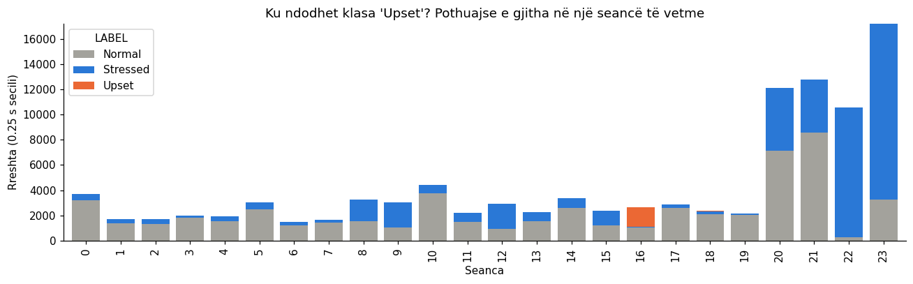
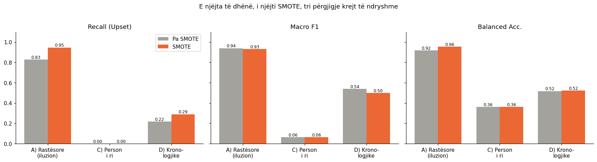
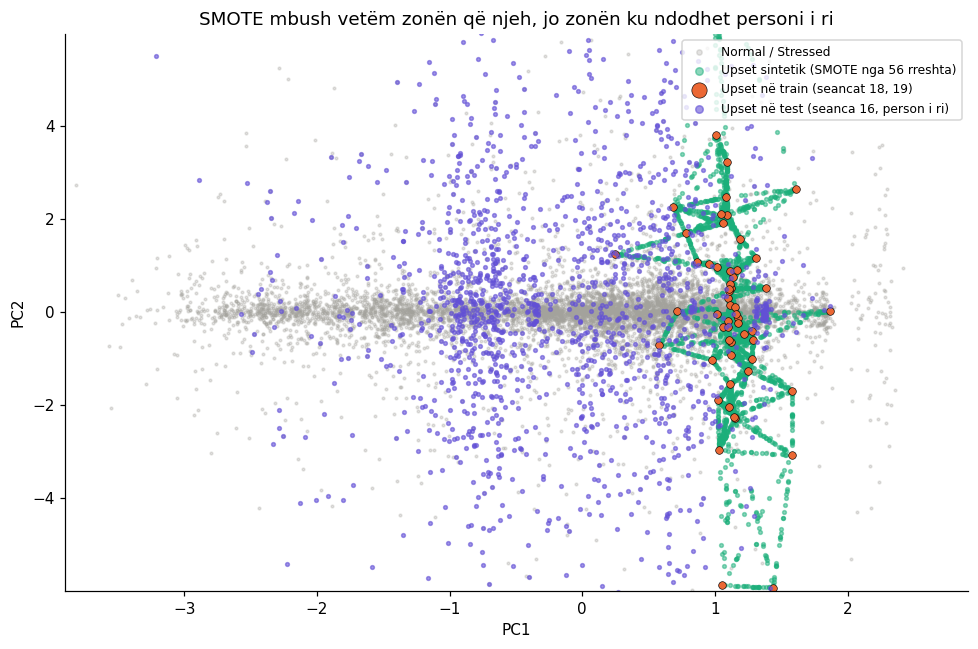
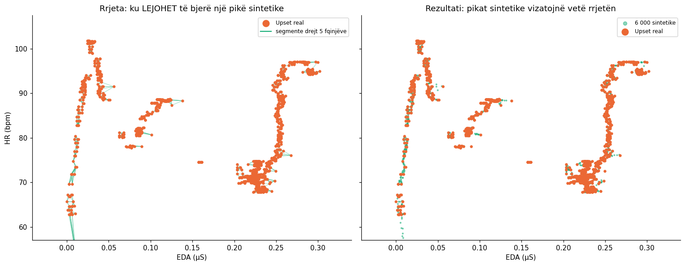

# The Missing 1.54%

**A mund ta mësojmë një makinë të njohë një gjendje emocionale që në dataset pothuajse nuk ekziston?**

*SMOTE implemented from scratch and tested on the BIOSTRESS physiological dataset: when synthetic oversampling helps, when it misleads, and why it balances numbers, not information.*

---

## Për çfarë bëhet fjalë

**SMOTE** (Synthetic Minority Over-sampling Technique) është teknika më e përdorur për klasat e pabalancuara. Ajo krijon mostra sintetike të klasës së pakicës duke interpoluar mes fqinjëve:

$$x_{ri} = x + \lambda \cdot (x_{fqinj} - x), \quad \lambda \sim U(0, 1)$$

Në këtë projekt, SMOTE është **implementuar nga e para me NumPy** ([smote.py](smote.py)) dhe është testuar në dataset-in **BIOSTRESS**. Dataset-i përmban sinjale fiziologjike nga byzylyku Empatica E4 (BVP, EDA, HR, akselerometri) dhe tri klasa: Normal (53.5%), Stressed (44.9%) dhe **Upset (vetëm 1.54%)**.

## Zbulimi kryesor

Dataset-i nuk ka kolonë për pjesëmarrësin. Por kur seancat rindërtohen nga kolona e kohës, del se:

> **96.5% e klasës Upset vjen nga një seancë e vetme**, rreth 6.4 minuta nga një person.



Kjo e ndryshon plotësisht kuptimin e çdo rezultati me SMOTE.

## Rezultatet

E njëjta të dhënë, i njëjti model (Random Forest) dhe i njëjti SMOTE, por tri mënyra të ndryshme të ndarjes train/test:

| Ndarja train/test | Recall (Upset) pa SMOTE | Recall (Upset) me SMOTE | Çfarë tregon |
|---|---|---|---|
| **A. Rastësore** (si në shumicën e tutorialëve) | 0.83 | **0.95** | Iluzion: 93% e rreshtave të testit kanë një "binjak" në train nga e njëjta seancë |
| **C. Person i ri** (seanca 16 jashtë trajnimit) | 0.00 | **0.00** | SMOTE nuk mund të krijojë diversitet që nuk ekziston |
| **D. Kronologjike** (70% e parë e çdo seance në train) | 0.22 | 0.29 | Recall rritet pak, por precision bie nga 0.48 në 0.18 dhe Macro F1 bie |



**Pse dështon te personi i ri?** SMOTE interpolon vetëm mes pikave që ekzistojnë. Pikat sintetike (me gjelbër) mbushin zonën e personave të njohur, ndërsa Upset-i i personit të ri (me vjollcë) ndodhet krejt diku tjetër:



## Çfarë përmban notebook-u

[SMOTE_BIOSTRESS.ipynb](SMOTE_BIOSTRESS.ipynb):

| Pjesa | Përmbajtja |
|---|---|
| 0 | Si funksionon SMOTE, hap pas hapi (2D) |
| 1 | Eksplorimi: sinjalet sipas klasës, rindërtimi i seancave, nga vjen klasa Upset |
| 2 | **Rasti A:** ndarje rastësore. Shpërndarja e klasave, PCA dhe matricat e konfuzionit para dhe pas SMOTE |
| 2b | **SMOTE nën mikroskop:** 8 vizualizime të mekanizmit mbi të dhënat reale |
| 3 | **Rasti B:** pse rezultati i rastit A është iluzion (analiza e fqinjëve në kohë) |
| 4 | **Rasti C:** testi i ndershëm me një person të ri |
| 5 | **Rasti D:** ndarje kronologjike brenda seancave |
| 6 | **Rasti E:** SMOTE kundrejt Random Oversampling dhe `class_weight`, si dhe efekti i `k` |
| 7 | Përfundimet |

### SMOTE nën mikroskop

| | Vizualizimi | Gjetja |
|---|---|---|
| M1 | Anatomia e një pike sintetike | E njëjta λ zbatohet për të gjitha veçoritë njëkohësisht |
| M2 | Rrjeta e segmenteve mbi EDA × HR | Pikat Upset formojnë trajektore kohore, dhe SMOTE i mbush vetëm përgjatë tyre |
| M3 | Mbushja hap pas hapi | Pjesa e Upset rritet nga 5% në 62% |
| M4 | Fqinjët në kohë | 99.6% e fqinjëve janë nga e njëjta seancë (mediana ~16 s larg) |
| M5 | Shpërndarjet reale kundrejt sintetike | Forma ruhet, por shpërndarja ngushtohet pak (σ ≈ 0.95–1.00) |
| M6 | Korrelacionet | Ruhen shumë mirë (diferenca maksimale 0.03) |
| M7 | "Territori i armikut" | Pikat sintetike janë *më të pastra* se ato reale (5% kundrejt 33% fqinjë jo-Upset) |
| M8 | Kufiri i vendimit | Zona Upset zgjerohet nga 8% në 17%, prandaj recall rritet dhe precision bie |



## Tri rregullat

1. SMOTE aplikohet **vetëm në train**, gjithmonë pas ndarjes.
2. Ndarja train/test duhet të pasqyrojë përdorimin real (persona, seanca, kohë), jo rreshta të rastësishëm.
3. Para SMOTE, pyet: **nga sa burime të pavarura vjen pakica?** Nëse vjen nga 1–2, problemi nuk zgjidhet me më shumë rreshta sintetikë, por me më shumë të dhëna reale.

## Struktura

```
├── SMOTE_BIOSTRESS.ipynb      # analiza e plotë
├── smote.py                   # implementimi i SMOTE nga e para (NumPy)
├── data/biostress/
│   ├── downsample.csv         # sinjalet (103 812 rreshta, 4 Hz)
│   └── surveydataset.csv      # pyetësori i pjesëmarrësve (nuk përdoret në analizë)
├── images/                    # grafikët për këtë README
└── requirements.txt
```

## Si ta ekzekutosh

```bash
pip install -r requirements.txt
jupyter notebook SMOTE_BIOSTRESS.ipynb
```

E testuar me Python 3.14, NumPy 2.4, pandas 3.0, scikit-learn 1.9 dhe matplotlib 3.10. Ekzekutimi i plotë zgjat disa minuta.

## Dataset-i

Kocaçınar, B., Patlar Akbulut, F., Çöpürkaya, Ç., Meriç, E., & Erik, E. B. (2023). *Examining psychological stress through the lens of physiological signals: BIOSTRESS dataset* (Version 1) [Data set]. Mendeley Data. https://doi.org/10.17632/z9y2fn38fp.1

Licenca: [CC BY 4.0](https://creativecommons.org/licenses/by/4.0/). Skedarët `downsample.csv` dhe `surveydataset.csv` janë përfshirë këtu **të pandryshuar**, ashtu siç janë shkarkuar nga Mendeley Data. Seancat në notebook rindërtohen gjatë analizës, pa i ndryshuar skedarët origjinalë.
